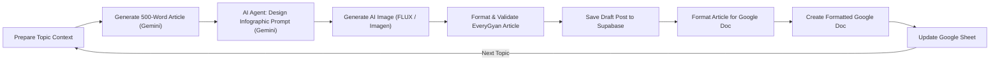

# n8n Workflow Upgrade: Automated AI Infographic & Cover Image Agent

This guide details how to add an AI Image Generation Agent to your existing **EveryGyan: Google Sheets Articles to Gemini Drafts** n8n pipeline.

---

## 1. Pipeline Architecture & Flow



---

## 2. The Two New Nodes to Add

### Node 1: `AI Agent: Design Infographic Prompt`
- **Node Type**: `@n8n/n8n-nodes-langchain.chainLlm` or `Basic LLM Chain`
- **Model**: Connected to your existing `Google Gemini Model`
- **Prompt**:
```text
You are an expert editorial infographic designer and art director for EveryGyan.

Based on the article below, create a highly detailed, concise visual generation prompt (under 60 words) for a high-resolution, modern editorial infographic or conceptual visual summary.

Article Title: {{ $('Generate 500-Word Article...').item.json.title || $('Prepare Topic Context').item.json.topic }}
Article Content: {{ $('Generate 500-Word Article...').item.json.text || $('Generate 500-Word Article...').item.json.content }}

Guidelines for the prompt:
- Style: Minimalist modern editorial vector infographic, clean lines, professional publication quality, isometric elements, soft color palette.
- Subject: Visual diagram/infographic summarizing the main concept or 3 key pillars of the topic.
- Format: 16:9 widescreen, no distorted or garbled text, high resolution.

Output ONLY the prompt text, nothing else.
```

---

### Node 2: `Generate AI Infographic / Cover Image`

#### Option A: Zero-Key Free FLUX Engine (Recommended — Fastest & Zero Setup)
Uses Black Forest Labs' state-of-the-art **FLUX.1** engine via Pollinations:
- **Node Type**: Code Node (or HTTP Request)
- **Node Name**: `Generate AI Infographic URL`
- **JavaScript Code**:
```javascript
const item = $input.item.json;
const rawPrompt = $('AI Agent: Design Infographic Prompt').item.json.text || item.topic || 'editorial knowledge illustration';

// Clean and encode the prompt
const cleanedPrompt = encodeURIComponent(
  rawPrompt.replace(/[\n\r]+/g, ' ').slice(0, 300) + ', editorial infographic, 8k, modern aesthetic'
);

const randomSeed = Math.floor(Math.random() * 1000000);
const imageUrl = `https://image.pollinations.ai/prompt/${cleanedPrompt}?width=1280&height=720&model=flux&nologo=true&seed=${randomSeed}`;

return {
  json: {
    ...item,
    image_prompt: rawPrompt,
    image_url: imageUrl,
    image_caption: `Figure 1: Visual Summary & Infographic Overview for ${item.title || item.topic}`
  }
};
```

---

#### Option B: Google Imagen 3 (via Gemini API)
If you prefer generating directly through Google AI with your existing Gemini API key:
- **Node Type**: `HTTP Request`
- **Method**: `POST`
- **URL**: `https://generativelanguage.googleapis.com/v1beta/models/imagen-3.0-generate-002:predict?key={{ $credentials.apiKey }}`
- **Body Content Type**: `JSON`
- **Body**:
```json
{
  "instances": [
    {
      "prompt": "{{ $('AI Agent: Design Infographic Prompt').item.json.text }}"
    }
  ],
  "parameters": {
    "sampleCount": 1,
    "aspectRatio": "16:9"
  }
}
```

---

## 3. Updated `Format & Validate EveryGyan Article` Code

Replace the code in your existing **Format & Validate EveryGyan Article** Code node with the following so it automatically:
1. Sets `cover_image` to the generated image.
2. Injects the infographic directly into the Markdown article body.
3. Formats source references and metadata for Supabase draft ingestion.

```javascript
const topicData = $('Prepare Topic Context').item.json;
const articleData = $('Generate 500-Word Article...').item.json;
const imageData = $('Generate AI Infographic URL').item.json;

const title = articleData.title || topicData.title || topicData.topic || 'Untitled Article';
const rawContent = articleData.text || articleData.content || '';
const category = (topicData.category || 'tech').toLowerCase();
const imageUrl = imageData.image_url;
const imageCaption = imageData.image_caption || `Visual Summary: ${title}`;

// Embed the infographic inside the article markdown right after the first section
const infographicMarkdown = `

---

## 📊 Visual Summary & Key Takeaways


*${imageCaption}*

---

`;

// Insert infographic after intro paragraph or at the top of content
let finalContent = rawContent;
if (finalContent.includes('\n\n')) {
  const parts = finalContent.split('\n\n');
  finalContent = parts[0] + '\n\n' + infographicMarkdown + '\n\n' + parts.slice(1).join('\n\n');
} else {
  finalContent = infographicMarkdown + '\n\n' + finalContent;
}

// Generate excerpt
const excerpt = articleData.excerpt || rawContent.replace(/#+\s+/g, '').slice(0, 150) + '...';

// Generate tags
const tags = topicData.tags || [
  category.charAt(0).toUpperCase() + category.slice(1),
  'Automated Draft',
  'AI Infographic'
];

// Fallback sources required by EveryGyan security invariants
const sources = topicData.sources || [
  {
    title: 'Editorial Research Reference',
    url: topicData.source_url || 'https://everygyan.com'
  }
];

return {
  json: {
    request_id: `n8n-${Date.now()}-${Math.random().toString(36).slice(2, 7)}`,
    title: title.trim(),
    excerpt: excerpt.trim(),
    content: finalContent.trim(),
    category: category,
    tags: tags,
    cover_image: imageUrl,
    cover_caption: imageCaption,
    status: 'draft',
    template_type: 'standard',
    source_urls: sources
  }
};
```

---

## 4. Result in EveryGyan
When this workflow runs:
1. **Article Cover Image**: Automatically displays the generated topic image on the Homepage, Category cards, and article header.
2. **Embedded Infographic**: Automatically displays a dedicated high-resolution visual summary inside the article body with an editorial caption.
3. **Google Docs & Google Sheets**: Includes the image URL in the generated Google Doc and records the completion in Google Sheets.
